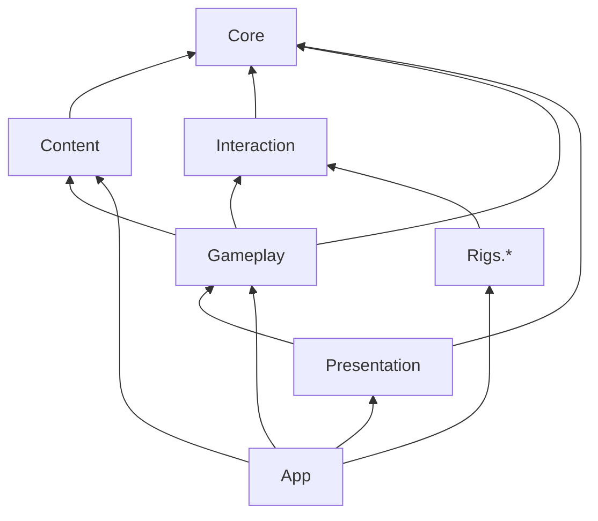

# Unity Game Architecture Rules

Enforceable structure for a Unity game project. Rationale and system overview are in `docs/architecture.md`.

`<Product>` is the project's assembly and namespace prefix in PascalCase (`<PRODUCT>` in upper case for defines); replace it during project initialization.

## Repository Layout

The Unity project lives at the repository root.

```text
Assets/
  _Project/            all project-owned assets and code
  <third-party>/       packages/assets that insist on their own root folder
Packages/              package manifest and lock
ProjectSettings/       Unity settings (committed)
SourceAssets/          .blend, .psd, raw audio; not imported by Unity (Git LFS)
docs/                  project documentation
.agents/               agent rules, skills, task notes
```

Never commit `Library/`, `Temp/`, `Obj/`, `Logs/`, `UserSettings/`, `Build/`, `Builds/`.

## `Assets/_Project/` Layout

```text
Assets/_Project/
  Scripts/
    Core/              <Product>.Core          pure C#, no UnityEngine
    Content/           <Product>.Content       ScriptableObject definition types
    Interaction/       <Product>.Interaction   device-neutral player interaction contracts
    Gameplay/          <Product>.Gameplay      scene bridge: views of Core state, game flow
    Presentation/      <Product>.Presentation  UI, audio, VFX
    Rigs/
      <Rig>/           <Product>.Rigs.<Rig>    one input setup each, e.g. Desktop, Gamepad, XR
    App/               <Product>.App           bootstrap, composition root, scene flow, save
    Dev/               <Product>.Dev           dev-only tools/cheats, excluded from release
    Editor/            <Product>.Editor        editor tooling, validators, importers
  Tests/
    EditMode/          <Product>.Tests.EditMode
    PlayMode/          <Product>.Tests.PlayMode
  Data/                ScriptableObject assets, one folder per definition type, e.g. Levels/, Items/, Characters/, Tuning/
  Prefabs/             one folder per kind, e.g. Characters/, Items/, Environment/, Rigs/, UI/
  Scenes/              Bootstrap, MainMenu, gameplay scenes, Sandbox/
  Art/                 Models/, Materials/, Textures/, Animations/, Shaders/, VFX/
  Audio/               Sfx/, Voice/, Music/
  Settings/            URP assets, Input System actions (Input/), lighting settings (Lighting/), presets
  ThirdParty/          vendored third-party assets + LICENSES.md
```

A game with a single input setup may keep one rig assembly; the seam stays so Gameplay never depends on a device.

Inside each script assembly, organize by feature, not by kind: `Core/Combat/`, `Core/Inventory/`, `Core/Progression/` — not `Core/Enums/`, `Core/Interfaces/`, `Core/Utils/`.

Do not create `Scripts/Managers/`, `Scripts/Utils/`, `Scripts/Helpers/`, or `Scripts/Misc/`.

## Assembly Definitions

Every script folder above is its own `.asmdef`. Rules for all project asmdefs:

- `autoReferenced: false`; references are explicit.
- Root namespace equals the assembly name.
- `<Product>.Core`: `noEngineReferences: true`. It must compile without `UnityEngine`.
- `<Product>.Editor` and test assemblies: Editor platform only / test assemblies as appropriate.
- `<Product>.Dev`: guarded by a define constraint (e.g. `<PRODUCT>_DEV`) so it is excluded from release builds.
- Third-party package references appear only in the assembly that owns that integration (e.g. an XR SDK or hand-interaction toolkit → `Rigs.XR` only).
- An assembly without scripts logs a harmless "will not be compiled" warning until its first script exists.

## Dependency Rule — Never Violate



| Assembly | May reference |
|----------|---------------|
| Core | nothing project-internal |
| Content | Core |
| Interaction | Core |
| Gameplay | Core, Content, Interaction |
| Presentation | Core, Gameplay |
| Rigs.* | Interaction |
| App | all runtime assemblies |
| Dev | any runtime assembly |
| Editor | any runtime assembly |
| Tests.EditMode | Core, Content, Editor (for validators) |
| Tests.PlayMode | any runtime assembly |

- No assembly references `Rigs.*` except `App` (and `Dev`/tests). Gameplay never knows which rig is active.
- No runtime assembly references `Editor`, and none but `Dev` itself references `Dev`. In this table "any runtime assembly" includes `Dev`, so `Editor` and `Tests.PlayMode` may reference it; `App` may not.
- Circular references are a design error; resolve by moving the shared contract down a layer.
- An EditMode architecture test (e.g. `Architecture/AssemblyDependencyTests`) enforces this table; add it with the first assemblies. A new assembly must be added to both the table and the test.

## Where New Code Goes

| What | Where |
|------|-------|
| Domain rule, calculation, state machine | `Core/<Feature>/` |
| New domain variant (a new kind of item, effect, action) | `Core/` enum + rules, then content data |
| ScriptableObject definition type for authored content | `Content/<Feature>/` |
| Tuning ScriptableObject a layer reads itself (interaction thresholds, a rig's input feel) | That layer's `Tuning/` folder or feature folder (`Interaction/Tuning/`, `Rigs/<Rig>/`): `Content` cannot be referenced below `Gameplay` |
| Authored content instance | `Data/<Kind>/` asset |
| Device-neutral interaction behaviour (grab, use, aim targets) | `Interaction/<Feature>/` |
| Component mirroring Core state on a scene object | `Gameplay/<Feature>/` |
| Game or level flow in the scene | `Gameplay/Flow/` |
| UI, HUD, audio playback, subtitles, result screens | `Presentation/<Feature>/` |
| Input handling for a device | `Rigs/<Rig>/` |
| Service wiring, scene loading, save/load, settings | `App/` |
| Cheats, scenario spawner, debug overlays, on-screen dev help | `Dev/` |
| Inspector, validator, importer, build script, prefab and scene generators | `Editor/` |

## Composition

- `App` owns a single composition root created in `Bootstrap`. It constructs services and passes them into scene objects via explicit initialization methods or serialized references.
- No DI framework, no service locator, no gameplay singletons.
- Core services receive their dependencies (RNG, content catalog, time) through constructors.
- Until `Bootstrap` exists, each sandbox scene has one composition component in `Dev` that wires it at runtime; prefabs never reference scene objects.

## Communication

- Downward: direct calls through references (Gameplay → Core commands).
- Gameplay, Interaction and the rigs never repeat a Core rule. Before offering an action they ask Core: a side-effect-free preview query answers what an action would do now without changing anything, and state queries describe the current state.
- Upward: C# events from the lower layer (Core raises `<Entity>StateChanged`; Gameplay and Presentation subscribe).
- Sideways between features in the same layer: through the next layer up or a shared Core event, not direct references across feature folders unless one clearly owns the other.
- A global event bus is not used.
